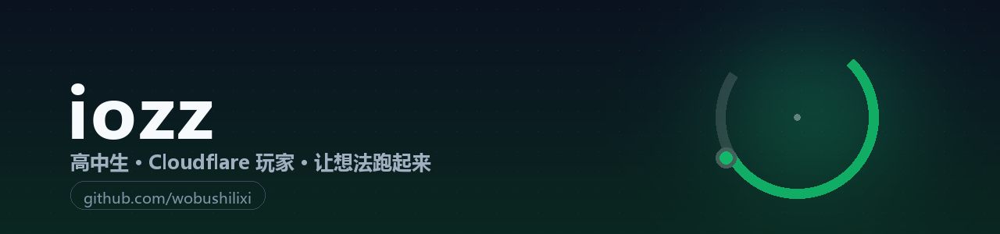

 

## 关于我

高中生。白天上课，晚上写点东西。

喜欢把脑子里的想法做成**能跑起来**的成品 —— 一个 925 KB 的原生 Windows 小工具、一个 Cloudflare Worker、一份逆向分析的笔记，都算。
比起「差不多能用」，更在意细节：动画够不够顺、字够不够清楚、用起来烦不烦。

- 🌱 最近在啃：图形渲染、系统级 C++、Android 加固与授权
- 🛠 日常工具：VS Code · Git · Cloudflare · IDA / jadx · PowerShell
- 💬 想聊点什么：欢迎开 issue，或者到 [iozz.cc](https://iozz.cc) 找我

## 作品

<table>
<tr>
<td width="50%" valign="top">

**🪑 [SitBreak](https://github.com/wobushilixi/sitbreak)**

久坐提醒 + 坐姿微训练。Direct2D 手写界面，925 KB 单文件、无运行时依赖，空闲约 0.3% CPU。

<code>C++</code> <code>Direct2D</code> <code>Win32</code>

</td>
<td width="50%" valign="top">

**🔍 [lixi-reverse](https://github.com/wobushilixi/lixi-reverse)**

Android 授权 / 卡密验证逆向分析技能包：四层判型 + 授权落点 L1–L5 判定，25 个标准库脚本。

<code>Python</code> <code>逆向</code> <code>方法论</code>

</td>
</tr>
<tr>
<td width="50%" valign="top">

**🖼 [Telegraph-Cloud](https://github.com/wobushilixi/Telegraph-Cloud)**

基于 Cloudflare Workers + Pages + Telegram 的无服务器图床，做过一轮性能与易用性改造。

<code>JavaScript</code> <code>Workers</code> <code>Serverless</code>

</td>
<td width="50%" valign="top">

**☁️ [CloudFlare-ImgBed](https://github.com/wobushilixi/CloudFlare-ImgBed)**

Cloudflare Pages + Telegram Bot 的免费图床方案（fork，参与维护与本地化）。

<code>JavaScript</code> <code>Cloudflare</code>

</td>
</tr>
<tr>
<td width="50%" valign="top">

**🌐 [free-proxy-nodes](https://github.com/wobushilixi/free-proxy-nodes)**

每日自动更新的 Clash / SOCKS5 节点，凭据轮换，仅供测试体验。

<code>Automation</code> <code>Network</code>

</td>
<td width="50%" valign="top">

**🌸 [iozz-blog](https://github.com/wobushilixi/iozz-blog)**

自己的小站，Miku 主题，写点技术笔记和生活碎片。

<code>Blog</code> <code>Frontend</code>

</td>
</tr>
</table>

## 数据

慢慢来，比较快。 — iozz · <a href="https://iozz.cc">iozz.cc</a>

